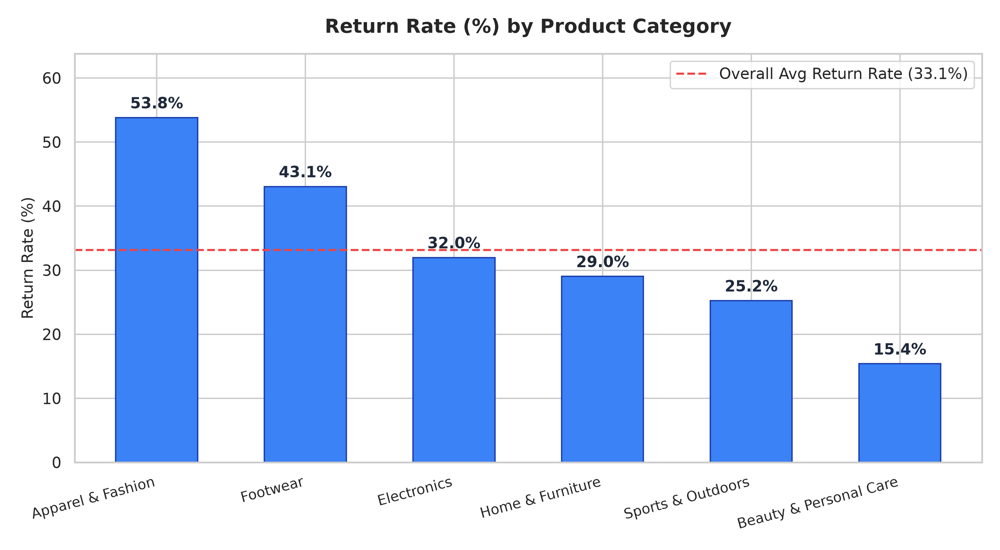

# E-Commerce Return Rate Reduction Analysis

An end-to-end Data Science, Machine Learning, and Business Intelligence project to diagnose why customers return products and how return rates vary across product categories, suppliers, marketing acquisition channels, and geographic regions.



---

## Project Structure
```text
E-commerce Return Rate Reduction Analysis/
├── data/
│   ├── raw/                           # Raw relational datasets (Orders, Returns, Products, Suppliers, Customers)
│   ├── processed/
│   │   ├── cleaned_ecommerce_returns.csv  # Flat master dataset (25,000 transactions)
│   │   └── powerbi_star_schema/       # Power BI Star Schema CSVs (Facts & Dims)
│   └── ecommerce.db                   # Indexed SQLite database
├── deliverables/
│   ├── high_risk_products.csv         # Ranked 41 high-risk SKUs with playbooks
│   ├── order_return_risk_scores.csv   # Scored orders with ML probability & risk tiers
│   └── return_rate_reduction_playbook.md # Executive reduction playbook
├── sql/
│   ├── schema.sql                     # Production DDL schema
│   └── return_analysis_queries.sql    # Analytical SQL queries (Category, Supplier, Channel, Geo)
├── src/
│   ├── data_generator.py              # Generates realistic synthetic e-commerce data
│   ├── data_cleaner.py                # Cleaning, ETL & dimensional modeling
│   ├── sql_analytics.py               # Executes SQL analytics against SQLite
│   ├── model_training.py              # Logistic Regression ML pipeline & odds ratios
│   ├── predict_risk.py                # Batch scoring & high-risk product extractor
│   ├── eda_visualizations.py          # High-resolution chart generator
│   └── export_dashboard_data.py       # Exports JSON data for interactive dashboard
├── powerbi/
│   ├── powerbi_measures.dax           # Production DAX measures
│   └── README_POWERBI_SETUP.md        # Step-by-step setup guide for Power BI Desktop
├── dashboard/                         # Live interactive web application
│   ├── index.html                     # Semantic HTML layout
│   ├── style.css                      # Modern dark theme with glassmorphism
│   ├── app.js                         # Dynamic drill-through, filter, search, & modal logic
│   └── data.json                      # Preloaded analytics & product payload
├── reports/
│   ├── Executive_Summary_Report.md    # Comprehensive analytics & findings report
│   └── figures/                       # ROC curves, confusion matrices, and charts
├── run_pipeline.py                    # Master orchestrator script
├── requirements.txt
└── README.md
```

---

## Quickstart

### 1. Clone the Repository
```bash
git clone https://github.com/sanjayfrancis20-cmd/E-commerce_Return_Rate_Reduction_Analysis.git
cd E-commerce_Return_Rate_Reduction_Analysis
pip install -r requirements.txt
```

### 2. Run the Entire Pipeline
To regenerate the dataset, clean data, execute SQL queries, train the Logistic Regression model, score high-risk products, and build all artifacts:
```bash
python run_pipeline.py
```

### 2. Launch the Interactive Dashboard
To launch the interactive dashboard locally:
```bash
python -m http.server 8080 --directory dashboard
```
Then navigate to: **`http://localhost:8080`** in your browser.

### 3. Open in Power BI Desktop
Follow the step-by-step instructions in [`powerbi/README_POWERBI_SETUP.md`](powerbi/README_POWERBI_SETUP.md) to load the files from `data/processed/powerbi_star_schema/` and import [`powerbi/powerbi_measures.dax`](powerbi/powerbi_measures.dax).

---

## Machine Learning Results
- **Model:** Penalized Logistic Regression (`scikit-learn`)
- **ROC-AUC Score:** `0.6980`
- **Accuracy:** `70.28%`
- **Top Risk Drivers (Odds Ratios):**
  - **Klarna / Buy Now Pay Later:** `1.54x` return odds multiplier
  - **Delivery Delay Days:** `1.304x` return odds per delay unit
  - **Customer Prior Return Rate:** `1.235x` return odds multiplier
  - **Apparel & Fashion:** Highest return propensity (53.81% vs 15.39% for Beauty)
